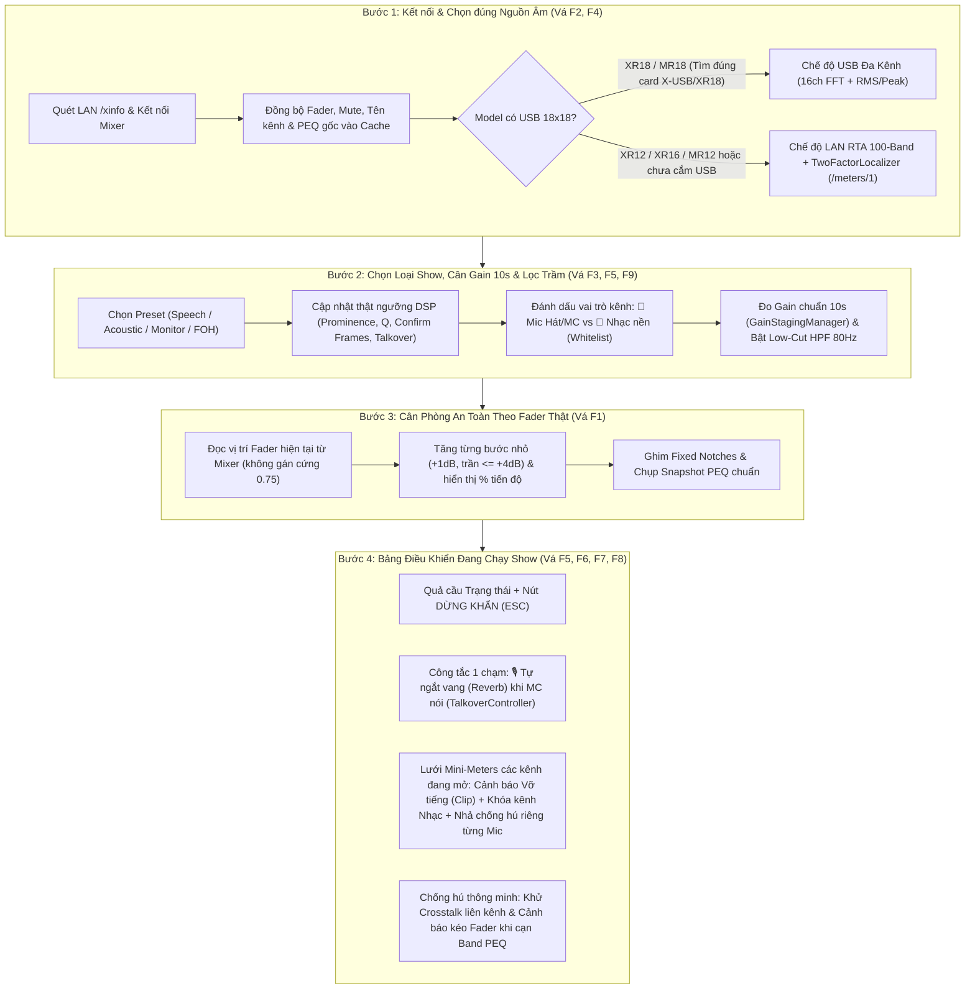

# PLAN — Nâng Cấp Toàn Diện Trợ Lý Chạy Show Đơn Giản (Simple Show Complete Assistant)

**Cơ sở nghiên cứu:** [`docs/research/simple-show-gaps.md`](../research/simple-show-gaps.md) (9 phát hiện kỹ thuật & vận hành từ F1 đến F9).

**Mục tiêu 1 câu:** Biến `tool xklive` từ một màn hình chỉ có "1 nút chống hú" thành **Trợ lý vận hành Show Đơn Giản khép kín và an toàn tuyệt đối** (Chuẩn bị nguồn âm → Cân Gain & Lọc trầm → Cân phòng an toàn theo Fader thật → Chống hú định vị đúng kênh + Tự ngắt vang MC + Giám sát trực tiếp từng Mic).

---

## 1. Kiến trúc Luồng Vận Hành Mới (End-to-End Simple Show Flow)

---

## 2. Phân bổ 4 Giai đoạn Thực thi (Phases & Deliverables)

### Phase 1 — Vá 4 Lỗi An Toàn Lõi & Đồng Bộ Phần Cứng (`src-tauri/src/`)
Giải quyết dứt điểm các lỗi có thể gây giật âm lượng, mất bảo vệ ngầm hoặc mất EQ gốc (F1, F2, F3, F4, F7) trước khi thêm giao diện mới.

| Mã | Công việc cụ thể | Tệp sửa đổi | Tiêu chí nghiệm thu (Verification) |
| :--- | :--- | :--- | :--- |
| **P1.1** | **Vá lỗi nhảy Fader khi Cân phòng (F1):** Trong `XAirClient::query_channel_configs`, bổ sung truy vấn `/lr/mix/fader`, `/bus/01..06/mix/fader`, `/fxrtn/01..04/mix/fader`. Trong `start_wizard`, đọc giá trị Fader thực tế từ `params_cache` (fallback về mức an toàn hiện tại nếu đang chạy Mock) để chỉ tăng tối đa `+3.0 dB` (trần cứng `+4.0 dB`) tính từ vị trí Fader thật của người dùng. | `src-tauri/src/mixer/xair.rs` `src-tauri/src/commands.rs` | Unit test xác nhận `start_wizard` khi fader đang ở `0.30` chỉ tăng từ `0.30` lên tối đa `~0.42`, không nhảy vọt lên `0.75`. |
| **P1.2** | **Vá lỗi chọn nhầm Mic Laptop & Mất LAN RTA (F2):** Thêm hàm tự động chọn thiết bị thu âm ưu tiên tên chứa `X-USB`, `X-AIR`, `XR18`, `MR18`, `BEHRINGER`, `MIDAS` (hoặc có `max_channels >= 8`). Nếu người dùng không truyền `device_name` và không tìm thấy soundcard đa kênh của mixer, **không tự động mở mic 1 kênh của laptop** mà giữ nguyên chế độ `LAN RTA` và báo rõ `audio_mode = "lan_rta"` trên UI. | `src-tauri/src/audio/mod.rs` `src-tauri/src/commands.rs` `src-tauri/src/state.rs` | Khi không cắm USB XR18, hệ thống báo `audio_mode = "lan_rta"` và luồng `RTADetector` trong `lib.rs` hoạt động 100%, không chiếm mic nội bộ của MacBook. |
| **P1.3** | **Biến Preset Bước 2 thành Cấu hình DSP Thật (F3):** Thêm command `apply_preset(preset: String)` trong `commands.rs` để tinh chỉnh trực tiếp `FeedbackDetector`, `RTADetector`, `SafetyState` và `TalkoverController`: - `speech`: `prominence = 8.5 dB`, `confirm_frames = 2`, `q = 6.5`, bật sẵn `talkover` cho Mic 1. - `acoustic`: `prominence = 12.0 dB`, `confirm_frames = 4`, `q = 10.0` (bảo vệ tối đa họa âm nhạc cụ). - `monitor`: `prominence = 9.5 dB`, `confirm_frames = 3`, `q = 8.0`. - `foh`: `prominence = 10.5 dB`, `confirm_frames = 3`, `q = 9.0`. | `src-tauri/src/commands.rs` `src-tauri/src/state.rs` `frontend/app/composables/useCompanionSocket.ts` | Unit test gọi `apply_preset("speech")` và `apply_preset("acoustic")` kiểm tra các tham số của `detector` và `talkover` thay đổi đúng đặc tả. |
| **P1.4** | **Bảo toàn PEQ gốc của Soundman & Cooldown RTA (F4, F7):** - Khi kết nối mixer, truy vấn các tham số `/eq/` hiện hành vào `params_cache`. - Trong `state.rs` và `commands.rs`, truyền closure đọc `params_cache` vào `decide(..., Some(&get_current_gain))` để lưu đúng `original_gain_db`, `original_freq_hz`, `original_q` trước khi cắt. - Thêm `cooldown_until: HashMap<usize, f64>` (2.0 giây) trong `RTADetector` để chặn bắn lặp đề xuất cùng 1 bin trong chế độ `semi`. | `src-tauri/src/mixer/xair.rs` `src-tauri/src/state.rs` `src-tauri/src/commands.rs` `src-tauri/src/dsp/rta_detector.rs` | Unit test xác nhận `panic_rollback` và `release_notch` khôi phục về đúng `original_gain_db` khác `0.0 dB` ban đầu; `RTADetector` không sinh đề xuất trùng trong cửa sổ cooldown. |

---

### Phase 2 — Kích Hoạt Các Mô-đun DSP Thông Minh (`Talkover`, `GainStaging`, `Localizer`, `HPF`)
Nối dây toàn bộ các mô-đun đã có trong `src-tauri/src/dsp/` vào vòng lặp thời gian thực và mở lệnh IPC cho Frontend (Vá F5, F6, F9).

| Mã | Công việc cụ thể | Tệp sửa đổi | Tiêu chí nghiệm thu (Verification) |
| :--- | :--- | :--- | :--- |
| **P2.1** | **Tự động ngắt vang khi MC nói (`TalkoverController` - F5):** - Thêm command `set_talkover_config(enabled: bool, mic_channel: Option<u8>, fx_return: Option<u8>, ducking_depth_db: Option<f32>)`. - Trong vòng lặp 250ms tại `lib.rs`, đọc mức tín hiệu dBFS của `mic_channel` (mặc định Mic 1) và `music_channels` (mặc định Kênh 15–18); khi nhạc nghỉ và MC nói, tự động hạ mượt Fader `/fxrtn/{01..04}/mix/fader` và trả lại khi nhạc lên hoặc hết câu. - **Chốt an toàn:** Nếu phát hiện người dùng chỉnh tay Fader FX trên bàn mixer, tạm khóa Talkover 10 giây (tôn trọng Manual Override). | `src-tauri/src/commands.rs` `src-tauri/src/lib.rs` `src-tauri/src/state.rs` `src-tauri/src/mixer/xair.rs` | Unit test xác nhận trạng thái `talkover_is_ducked` bật khi `mic > -42 dBFS` và `music < -48 dBFS`, tự nhả sau `hold_time_s`. |
| **P2.2** | **Đo Gain chuẩn 10s & Cảnh báo Vỡ tiếng (`GainStagingManager` - F5):** - Thêm các command: `start_gain_calibration(channel: u8)`, `cancel_gain_calibration(channel: u8)`. - Trong luồng thu âm & vòng lặp 250ms (`lib.rs`), cập nhật mức Peak/RMS từng kênh vào `gain_staging.process_meter_sample()`. - Đẩy danh sách `clip_alerts` và trạng thái `gain_sessions` vào `FullStateSnapshot` để hiển thị trực tiếp trên Bước 2 và Bước 4. | `src-tauri/src/dsp/gain_staging.rs` `src-tauri/src/commands.rs` `src-tauri/src/lib.rs` `src-tauri/src/state.rs` | Khi tín hiệu kênh vượt `-0.5 dBFS` trên `300ms`, `FullStateSnapshot.clip_alerts` ghi nhận đúng kênh bị vỡ tiếng. |
| **P2.3** | **Định vị kênh hú 2 yếu tố & Chống cắt nhầm Crosstalk (F6):** - **Chế độ LAN RTA:** Khi `RTADetector` phát hiện hú trên Main LR nhưng `/meters/1` cho thấy 1 kênh micro đang vượt trội rõ rệt (qua `TwoFactorLocalizer`), gắn thông tin `suspected_channel` vào đề xuất/nhật ký để báo cho người dùng biết *"Nghi ngờ hú từ Mic X"*. - **Chế độ USB Đa kênh:** Nếu trong cùng 1 cửa sổ 80ms có `>= 2` kênh cùng báo hú tại cùng tần số (`±3%`), chỉ giữ lại đề xuất của kênh có năng lượng đỉnh lớn nhất (Dominant Channel Veto) để không cắt nhầm các mic lân cận bị lọt âm (crosstalk). | `src-tauri/src/lib.rs` `src-tauri/src/commands.rs` `src-tauri/src/state.rs` | Unit test mô phỏng 3 kênh cùng nhận sóng sin 2.5kHz với biên độ `-10 dBFS`, `-22 dBFS`, `-25 dBFS` → chỉ kênh 1 bị cắt PEQ. |
| **P2.4** | **Bật nhanh Lọc Trầm (Low-Cut HPF 80Hz) cho Kênh Micro (F9):** - Thêm command `apply_channel_hpf(channel: u8, enabled: bool, freq_hz: Option<f32>)` gửi lệnh OSC `/ch/{01..16}/preamp/hpon` (`1`/`0`) và `/ch/{01..16}/preamp/hpf` (chuẩn hóa logarit 20Hz–400Hz, mặc định `80Hz`). | `src-tauri/src/mixer/xair.rs` `src-tauri/src/commands.rs` | Gọi `apply_channel_hpf(1, true, Some(80.0))` gửi đúng gói OSC chuẩn hóa và ghi nhận vào `expected_echoes`. |

---

### Phase 3 — Cải Tiến Giao Diện Easy Mode (Bước 1 → Bước 4)
Thiết kế theo đúng nguyên lý `METHOD-ux-psych.md` (Ngân sách nhận thức tối thiểu, Nhận diện thay vì ghi nhớ, Mặc định thông minh, Ngôn ngữ đời thường).

| Mã | Màn hình | Những gì được nâng cấp trên giao diện |
| :--- | :--- | :--- |
| **P3.1** | **Header & Bước 1** (`EasyModeView.vue`, `EasyStepConnect.vue`) | - Hiển thị huy hiệu chế độ bảo vệ rõ ràng trên thanh Header: **`🔌 USB Đa Kênh (Bảo vệ từng Mic)`** hoặc **`🌐 LAN RTA (Bảo vệ Loa Tổng)`** kèm đèn báo độ trễ mạng (`rttMs`). - Cho phép chọn nhanh thiết bị thu âm USB ngay tại Bước 1 nếu máy tính cắm nhiều soundcard. |
| **P3.2** | **Bước 2: Kiểm tra Mic & Chuẩn bị Kênh** (`EasyStepMicCheck.vue`) | - Trên mỗi thẻ Micro, bổ sung 3 tác vụ 1 chạm:   1. **Chọn vai trò kênh:** `🎤 Mic Hát/MC` (bật bảo vệ chống hú) hoặc `🎵 Nhạc nền / Nhạc cụ` (đưa vào Whitelist bảo vệ nguyên bản, không bao giờ bị cắt EQ).   2. **Nút `⚖️ Đo Gain 10s`:** Người dùng nói thử 10 giây → hiện kết quả trực quan (*"Gain chuẩn đẹp"* hoặc *"Hơi nhỏ: hãy vặn núm Gain kênh này thêm +4 dB"*).   3. **Nút `🛡️ Lọc tiếng bụp/ù (80Hz)`:** Bật Low-Cut HPF 80Hz cho micro chỉ với 1 cú bấm. |
| **P3.3** | **Bước 3: Cân Phòng** (`EasyStepWizard.vue`) | - Hiển thị thanh tiến trình % thực tế (`+0.0 dB → +3.0 dB` dựa trên `current_gain_added`) và danh sách các điểm tần số cộng hưởng vừa được xử lý để người dùng yên tâm quan sát. |
| **P3.4** | **Bước 4: Đang Chạy Show** (`EasyStepLiveShow.vue` — **Trọng tâm**) | Giữ nguyên quả cầu trạng thái lớn và nút `DỪNG KHẨN` ở trên, bổ sung 3 khối điều khiển thực chiến bên dưới: 1. **Thanh công cụ nhanh "Trợ lý MC & Sân khấu":** Nút bật/tắt **`🎙️ Tự ngắt vang (Reverb) khi MC nói`** (hiện trạng thái sáng xanh *"Đang hạ vang cho MC nói rõ chữ"* khi kích hoạt). 2. **Bảng "Trạng thái các Kênh trực tiếp" (Compact Live Strip):** Hiển thị gọn các kênh đang dùng với thanh mức âm lượng thời gian thực, huy hiệu đỏ nhấp nháy **`⚠️ VỠ TIẾNG (Giảm Gain)`** nếu bị Clip, nút khóa **`🎵 Kênh Nhạc`** và huy hiệu số điểm hú đang cắt trên kênh đó kèm nút **`↩️ Nhả riêng mic này`** (thay vì phải bấm Panic xóa toàn bộ bàn). 3. **Cảnh báo thông minh khi hú vượt ngưỡng EQ:** Khi một kênh đã cắt hết cả 2 band PEQ ở mức sâu (`<= -9 dB`) mà vẫn tiếp tục hú, hiện cảnh báo rõ: *“⚠️ Mic X đang mở quá lớn hoặc chĩa thẳng vào loa — Hãy kéo nhẹ âm lượng (Fader) của Mic X xuống!”* |

---

### Phase 4 — Kiểm Thử Tự Động & Đồng Bộ Tài Liệu
- **P4.1:** Bổ sung unit test trong `src-tauri/src/` cho seluruh luồng mới (`apply_preset`, `start_wizard` với fader thực, `talkover` IPC, `gain_staging` clip alert, `localizer` crosstalk veto, `rta_detector` cooldown). Đảm bảo `cargo test --manifest-path src-tauri/Cargo.toml` đạt 100% pass.
- **P4.2:** Kiểm tra typecheck và build tĩnh giao diện Nuxt 4 (`npm run generate`) không có lỗi.
- **P4.3:** Cập nhật [`docs/API.md`](../API.md) và [`BAO_CAO_DU_AN.md`](../../BAO_CAO_DU_AN.md) phản ánh đầy đủ các lệnh IPC và tính năng mới.

---

## 3. Kiểm Soát Rủi Ro & Bất Biến An Toàn (Safety Invariants Checklist)

1. **Cách ly tuyệt đối Audio Plane / Control Plane:** Mọi tính năng mới (`Talkover`, `GainStaging`, `HPF`, `Preset`) chỉ gửi thông điệp điều khiển OSC nhẹ qua UDP cổng `10024` (hoặc đưa ra khuyến nghị hiển thị). Nếu tắt app hoặc rút cáp mạng, âm thanh trên sân khấu không bao giờ bị ngắt.
2. **Tôn trọng quyền tối cao của Soundman (Manual Override Lock 10s):** Nếu kỹ thuật viên tự tay kéo Fader FX hoặc vặn EQ trên iPad/mixer, hệ thống khóa can thiệp tự động trên đối tượng đó trong 10 giây và cập nhật lại mốc tham chiếu theo tay người dùng.
3. **Ưu tiên băng thông UDP cho lệnh cắt hú:** Lệnh làm mượt Fader của `TalkoverController` không được vượt quá tần suất an toàn và luôn nhường quyền ưu tiên tuyệt đối cho các gói tin cắt hú PEQ khẩn cấp.
4. **Trần an toàn bất biến:** Không bao giờ boost EQ hoặc tăng Fader Ring-Out quá `+4.0 dB` so với mức khởi điểm thực tế; không bao giờ cắt PEQ sâu quá `-12.0 dB`.
